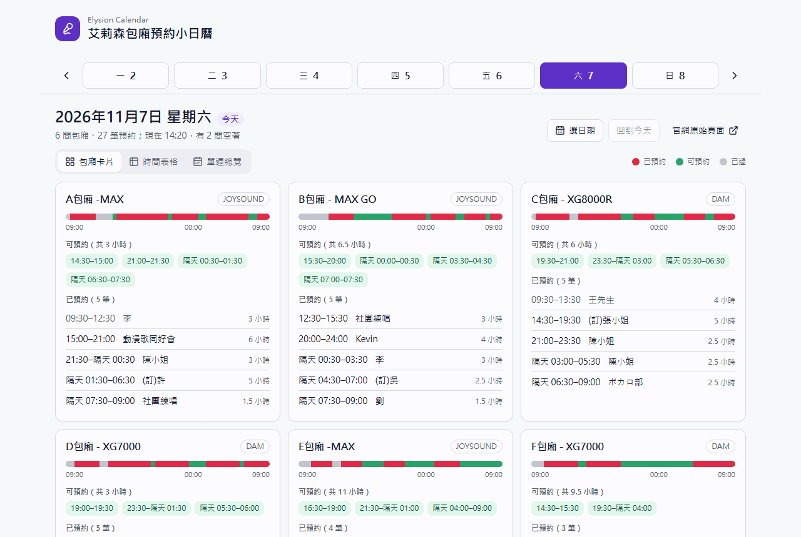
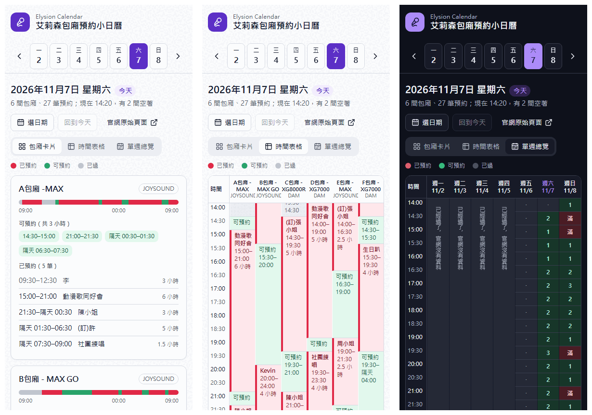
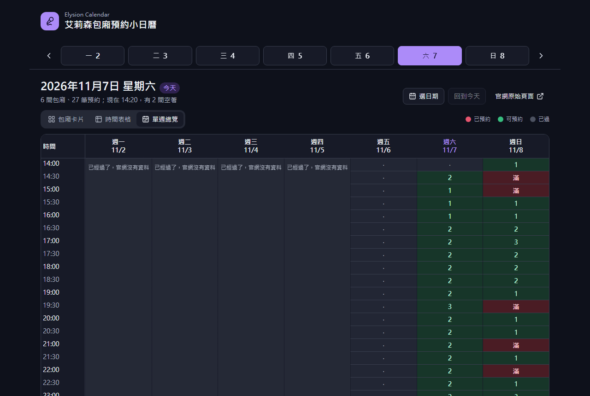
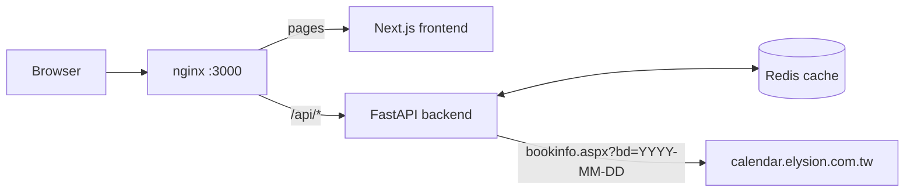

# Elysion Calendar

[](https://github.com/NatLee/elysion-calendar/actions/workflows/ci.yml)
[](./LICENSE)


快速查詢艾利森日K用的小小日曆 🥰

A small web app for checking which private karaoke rooms at Elysion (艾莉森) are free.
It reads the shop's official booking page and shows the same data in a way that is quick
to scan: one card per room, a full-day time table, and a weekly overview of how many
rooms are still free in every half hour. Works on a phone, follows your light/dark setting.



## What's on the page

Pick a day in the week strip at the top (or open **選日期** for the month calendar, or
**回到今天** to jump back). Everything below follows that day.

| Tab | What it answers |
|---|---|
| **包廂卡片** (room cards) | For each room: its karaoke system (JOYSOUND / DAM), a bar of the whole day, the free periods still ahead, and the bookings. |
| **時間表格** (time table) | Time down the side, rooms across the top, from 09:00 until 09:00 the next morning. Each booking is one block; on today's page it scrolls to the current time. |
| **單週總覽** (weekly overview) | Every half hour of the week with the number of rooms still free (滿 = all booked). Click a day to open its time table. |

Slots that have already started turn grey, using the shop's clock (Taiwan time) rather
than your device's. Days that are over have no data on the official site, so they show a
short note instead.





> The screenshots use made-up bookings from a local copy of the booking page, with the clock
> set to Saturday 2026-11-07 14:20.

## Quick start (Docker)

You need Docker with the compose plugin.

```bash
git clone https://github.com/NatLee/elysion-calendar.git
cd elysion-calendar
./prod.sh            # same as: docker compose up --build
```

Open <http://localhost:3000>. This starts four containers: nginx on port 3000, the
Next.js frontend, the FastAPI backend and Redis.

## Development

### Everything in Docker, with reload

```bash
./dev.sh             # same as: docker compose -f docker-compose.dev.yml up --build
```

- App: <http://localhost:3000> (`next dev`, reloads when you edit `frontend/`)
- API: <http://localhost:8000/api/daily-schedule/2026-11-07> (uvicorn `--reload`, edits in `backend/`)

### Frontend on your machine

Node.js 20.9 or newer. Start the backend and Redis from the dev compose file, then run
the frontend locally; it forwards `/api/*` to `http://localhost:8000` (set `API_ORIGIN`
to use another backend).

```bash
docker compose -f docker-compose.dev.yml up --build backend redis

cd frontend
npm ci
npm run dev          # http://localhost:3000
```

### Checks

The same checks run in GitHub Actions on every push and pull request.

```bash
cd frontend
npm run lint         # ESLint
npm run typecheck    # TypeScript
npm test             # Vitest: dates, slots, ranges, the weekly overview maths
npm run build        # production build

cd ../backend
pip install -r requirements-dev.txt
python -m pytest     # parser + API, with a fake Redis and a saved copy of the page
```

## Where the data comes from



- **Source.** The official booking page, `https://calendar.elysion.com.tw/bookinfo.aspx?bd=<date>`,
  has one table per room: 48 half-hour cells from 09:00 to 09:00 the next morning, with
  booked cells coloured in. The backend reads the start time, slot length and slot count
  from the hour labels under each table, so the app follows if the shop changes them.
- **Why a backend.** The official site does not allow cross-origin requests (no CORS
  headers), so a page in your browser cannot read it directly.
- **Freshness.** Each day is kept in Redis for an hour. Once a copy is older than five
  minutes, the next request still gets it right away and a background job fetches a new
  one, so what you see is normally at most a few minutes behind the official page. Only one
  request per day talks to the official site at a time; others wait for it.
- **Past days.** The official site answers "已過期，無資料顯示 !" for days that are over, so
  the app has nothing to show for them.

### API

`GET /api/daily-schedule/{YYYY-MM-DD}`

```json
{
  "date": "2026-11-08",
  "url": "https://calendar.elysion.com.tw/bookinfo.aspx?bd=2026-11-08",
  "grid": { "start_minutes": 540, "slot_minutes": 30, "slot_count": 48 },
  "rooms": [
    {
      "id": 0,
      "name": "A包廂 -MAX",
      "system": "JOYSOUND",
      "bookings": [
        { "customer": "Kevin", "start_time": "10:00", "end_time": "17:00", "duration": "7小時", "start_slot": 2, "slot_count": 14 },
        { "customer": "黃先生", "start_time": "17:30", "end_time": "23:30", "duration": "6小時", "start_slot": 17, "slot_count": 12 }
      ]
    }
  ]
}
```

- `grid` is `null` and `rooms` is empty when the official site has no data for that day.
- `start_slot` / `slot_count` count cells from the start of the grid; `start_time` and
  `end_time` are on a 24-hour clock and may be on the next morning (`23:30` to `06:30`).
- Errors: `422` for a date that is not `YYYY-MM-DD`, `502` when the official site is
  down or its page changed, `503` when it is too slow to answer.
- `Cache-Control: max-age` says how many seconds the copy stays fresh.

## Configuration

| Where | Setting | Default |
|---|---|---|
| backend env | `SOURCE_URL` — the booking page to read | `https://calendar.elysion.com.tw/bookinfo.aspx` |
| backend env | `REDIS_URL` | `redis://localhost:6379/0` |
| backend env | `CORS_ORIGINS` — comma separated | `http://localhost` |
| frontend env | `API_ORIGIN` — backend for `next dev` / `next start` without nginx | `http://localhost:8000` |
| `frontend/src/config/site.ts` | shop time zone, first day of the week, page title | `Asia/Taipei`, Monday |

## Project layout

```text
backend/            FastAPI app (app.py), page parser (parse_room_schedule.py), tests/
frontend/           Next.js app
  src/config/       shop and data-source settings
  src/lib/          date and slot maths (pure functions, with tests), API client
  src/hooks/        shop clock, shared day store
  src/components/   week strip, date picker, room cards, time table, weekly overview
nginx/default.conf  production reverse proxy
doc/                screenshots
```

## Contributors

<!-- ALL-CONTRIBUTORS-LIST:START - Do not remove or modify this section -->
<!-- prettier-ignore-start -->
<!-- markdownlint-disable -->

<table>
  <tbody>
    <tr>
      <td align="center"><a href="https://github.com/NatLee"><br /><sub><b>Nat Lee</b></sub></a></td>
      <td align="center"><a href="https://github.com/kidkcl"><br /><sub><b>kidkcl</b></sub></a></td>
    </tr>
  </tbody>
</table>

<!-- markdownlint-restore -->
<!-- prettier-ignore-end -->

<!-- ALL-CONTRIBUTORS-LIST:END -->

## License

[MIT](./LICENSE)
